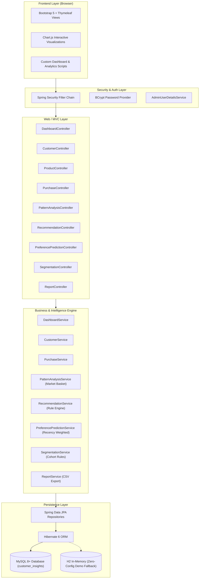

# Personalized Customer Insights Through Purchase Patterns and Preference Prediction

A modern, responsive, full-stack enterprise web application built with **Java 21**, **Spring Boot 3**, **Spring Data JPA / Hibernate**, **Spring Security 6**, **MySQL**, **Thymeleaf**, **Bootstrap 5**, and **Chart.js**.

The platform enables online retail stores and e-commerce enterprises to analyze customer purchase histories, identify seasonal and basket shopping patterns, model customer affinities, and predict future category preferences to deliver explainable, rule-based product recommendations.

---

## 1. System Architecture & Tech Stack



### Technology Matrix
* **Backend Framework:** Spring Boot 3.3.4 with Java 21
* **Database:** MySQL 8+ (with H2 in-memory profile available for instant demo)
* **ORM & Database Connectivity:** Spring Data JPA with Hibernate 6
* **Security:** Spring Security 6 with BCrypt password hashing and session authentication
* **Template Engine:** Thymeleaf 3 with Thymeleaf Spring Security 6 dialect
* **Frontend Framework:** Bootstrap 5.3.3 & Bootstrap Icons 1.11.3
* **Charts & Data Visualization:** Chart.js 4.4.2
* **Build Tool:** Apache Maven 3.9+ (includes Maven Wrapper `mvnw` / `mvnw.cmd`)

---

## 2. Key Modules & Functional Features

### A. Authentication & Admin Security
* Protected administrator dashboard routes (`ROLE_ADMIN`).
* Custom styled login card at `/login` with invalid credentials and logout alert handlers.
* One-click **Auto-Fill Demo Credentials** button for seamless evaluation.
* Passwords stored using industry-standard **BCrypt** hashing.

### B. Executive Analytics Dashboard
* **Dynamic KPI Summary Cards:**
  * Total Lifetime Revenue (formatted with currency separators).
  * Total Orders & Store Average Order Value (AOV).
  * Total Registered Customers.
  * Customer Retention: Returning vs. New customers (< 30 days).
* **4 Live Chart.js Charts:**
  1. *Monthly Sales Trend:* Dual-axis line chart depicting monthly revenue and order volume across the last 6 months.
  2. *Product Category Distribution:* Doughnut chart representing sales share across all merchandise categories.
  3. *Customer Purchase Frequency:* Bar chart grouping customers by repeat order frequency (1, 2-3, 4-6, 7+ orders).
  4. *Top-Selling Products:* Horizontal bar chart ranking highest-velocity products.
* **Live Recent Transactions:** Table of the latest customer purchases with status badges and invoice links.

### C. Customer Management (Customer 360)
* View paginated list of customers with search by name or email, and status filtering (`ACTIVE` / `INACTIVE`).
* **Add & Edit Customers:** Full form validation (name, unique email, phone, city, registration date, status).
* **Delete Customer:** Safe deletion with confirmation modal.
* **Customer 360 Profile (`/customers/view/{id}`):**
  * Profile overview with avatar and customer segment badge.
  * Lifetime transactions, total spend, and favorite category.
  * Complete purchase history list for the selected customer.
  * Direct product recommendation cards curated specifically for this customer.

### D. Purchase History & Order Auditing
* Paginated order history with multi-criteria filtering:
  * Filter by specific customer dropdown.
  * Filter by product category.
  * Filter by start date and end date range.
  * Search by customer name or email.
* Real-time metric summary of the filtered result set: Filtered Revenue, Filtered Order Count, Filtered AOV.
* **Printable Invoice Detail View (`/purchases/{id}`):** Itemized breakdown with product name, category, quantity, unit price, and subtotal.

### E. Product Management & Inventory
* Catalog list with search, category filtering, and pagination.
* Low-stock warning banner notifying administrators when items have 20 units or fewer in warehouse.
* Add, edit, and delete products with validation on price and stock quantity.

### F. Purchase Pattern & Market Basket Analysis (`/patterns`)
* **Seasonal Purchasing Trends:** Calculates revenue across Q1 (Winter), Q2 (Spring), Q3 (Summer), and Q4 (Fall/Holiday).
* **Market Basket Analysis (Co-Occurrence Engine):** Identifies pairs of products `(Product A, Product B)` frequently purchased together in multi-item orders.
  * Calculates joint frequency count and association confidence percentage:
    $$\text{Confidence}(A \to B) = \frac{\text{Count}(A \cap B)}{\text{Count}(A)} \times 100\%$$
  * Displays actionable bundling and cross-sell marketing insights.
* Velocity rankings for top products, popular categories, top spenders, and frequent buyers.

### G. Personalized Recommendation Engine (`/recommendations`)
* **Two Complementary Modes:**
  1. **Interactive Preference Advisor (Dynamic Category Quiz):**
     * Select any category (Shoes, Electronics, Audio & Wearables, Computer Accessories, Smart Home, Home Appliances).
     * **Dynamically adjusts relevant questions**: Selecting *Shoes* presents Size, Purpose (Running/Walking/Sports), Comfort, Durability, Price, and Brand preferences — *never* irrelevant questions like storage, battery life, or screen size. Selecting *Electronics* displays display size, storage, and battery.
     * Computes matching confidence percentage and presents transparent, explainable recommendations.
  2. **Customer Account History Engine:**
     * Historical Analysis: Evaluates past orders to compute category affinity (60% frequency weight, 40% spend weight).
     * Candidate Filtering: Prioritizes unpurchased products from preferred categories with stock availability.
     * Composite Score: $(0.50 \times \text{Affinity}) + (0.30 \times \text{Popularity}) + (0.20 \times \text{Stock Bonus})$.
* **REST API Endpoints (`/api/recommendations/**`):**
  * `GET /api/recommendations/categories` — list of merchandise categories.
  * `GET /api/recommendations/questions?category={cat}` — dynamic questions schema for any category.
  * `POST /api/recommendations/quiz` / `GET /api/recommendations/quiz?category=Shoes&purpose=Running` — preference-based recommendations.
  * `GET /api/recommendations/customer/{id}` — customer profile recommendations.

### H. Customer Preference Prediction (`/predictions`)
* Rule-based predictive modeling incorporating **recency decay weighting**:
  * Orders placed within the last 45 days receive a **1.5x recency multiplier**.
  * Orders placed within 45–90 days receive a **1.2x recency multiplier**.
  * Older orders receive a baseline **1.0x multiplier**.
* Calculates category affinity scores (0–100%) and projects top future category interest.
* Interactive Chart.js preference distribution bar chart and detailed metrics table.
* **Insufficient Data Protection:** If a customer has completed fewer than 2 orders, the system displays an explicit warning asking for more purchase history rather than generating misleading predictions.

### I. Customer Segmentation (`/segments`)
* Automatically cohorts customers into 5 business segments:
  1. **High-Spending Customers:** Total spending $\ge \$1,000.00$.
  2. **Frequent Buyers:** Total orders $\ge 5$ and spending $< \$1,000.00$.
  3. **Occasional Buyers:** Total orders between 2 and 4.
  4. **New Customers:** Registered within 60 days with $\le 1$ order.
  5. **Inactive Customers:** Registered $> 60$ days ago with 0 orders.
* Polar area distribution chart and interactive accordion listing all customers in each cohort.

### J. Reports & CSV Data Export (`/reports`)
* Tabbed report views for:
  * Sales Report (with customizable date range).
  * Customer Purchase Report.
  * Product Popularity Report.
  * Category Preference Report.
  * Customer Segmentation Report.
* **Export to CSV:** Direct browser file download with streaming CSV headers (`text/csv`) and timestamped filenames.

---

## 3. Database Schema

The database is structured in MySQL under the schema `customer_insights`:

1. `admins`: Administrator credentials, BCrypt password, email, and role.
2. `customers`: Customer profiles, contact details, registration date, and account status.
3. `products`: Product catalog, categories, pricing, stock levels, and descriptions.
4. `orders`: Orders placed by customers with total amounts, dates, and payment methods.
5. `order_items`: Order line items associating orders with products, quantities, unit prices, and line totals.

Schema initialization and sample data are provided in:
* `src/main/resources/schema.sql` (DDL)
* `src/main/resources/data.sql` (DML)
* `DataInitializer.java` (Automated Spring Boot seeder with 25 customers, 18 products, and 60+ orders)

---

## 4. Setup and Execution Instructions

### Prerequisites
* **Java Development Kit (JDK):** Version 21 (or 17+)
* **Database:** MySQL Server 8.0+ (Optional: application can also run with H2 fallback)
* **Build Tool:** Apache Maven 3.9+ (or use the included `./mvnw` / `mvnw.cmd`)

---

### Step 1: Clone or Open Project
Clone the repository:
```bash
git clone https://github.com/kishorenk137/product-recommendation.git
cd product-recommendation
```

---

### Step 2: Configure MySQL Database
1. Start your local MySQL service (e.g. via MySQL Workbench, XAMPP, or command line).
2. Create the database:
   ```sql
   CREATE DATABASE customer_insights;
   ```
3. Update database credentials in `src/main/resources/application-mysql.properties` or set environment variables:
   ```properties
   spring.datasource.url=jdbc:mysql://localhost:3306/customer_insights?createDatabaseIfNotExist=true&useSSL=false&allowPublicKeyRetrieval=true&serverTimezone=UTC
   spring.datasource.username=root
   spring.datasource.password=your_mysql_password
   ```
   *Alternatively, pass environment variables:*
   ```powershell
   $env:DB_URL="jdbc:mysql://localhost:3306/customer_insights?createDatabaseIfNotExist=true&useSSL=false"
   $env:DB_USERNAME="root"
   $env:DB_PASSWORD="your_mysql_password"
   ```

> **Instant Demo Option (No MySQL Required):**
> If MySQL is not running on your machine, you can run the application immediately in embedded in-memory mode:
> ```powershell
> ./mvnw.cmd spring-boot:run -Dspring-boot.run.profiles=h2
> ```

---

### Step 3: Build & Run the Application

Using the Maven Wrapper on Windows:
```powershell
.\mvnw.cmd spring-boot:run
```

Or using standard Maven:
```bash
mvn clean spring-boot:run
```

On Linux / macOS:
```bash
./mvnw spring-boot:run
```

The Spring Boot application will start on port `8080`.
Upon first launch, `DataInitializer` automatically seeds:
* 1 Demo Administrator Account
* 25 Fictional Customers across diverse US cities
* 18 Products across 5 categories
* 60+ Orders distributed across the past 12 months with realistic basket co-occurrences

---

### Step 4: Open in Web Browser

Navigate to:
```
http://localhost:8080
```

You will be redirected to the secure login page:
```
http://localhost:8080/login
```

---

### Step 5: Demo Administrator Login

Use the documented credentials or click the **Auto-Fill** button on the login card:
* **Username:** `admin`
* **Password:** `admin123`

---

## 5. Web Application Route Directory

| URL Path | Method | Description |
|---|---|---|
| `/login` | `GET`, `POST` | Administrator login and authentication processing |
| `/logout` | `POST` | Invalidates session and logs out administrator |
| `/dashboard` | `GET` | Executive dashboard with KPIs, 4 Chart.js charts & recent purchases |
| `/customers` | `GET` | Customer list with search, status filters, and pagination |
| `/customers/new` | `GET`, `POST` | Add customer form with validation |
| `/customers/edit/{id}` | `GET`, `POST` | Edit customer profile form |
| `/customers/view/{id}` | `GET` | Customer 360 profile with purchase history & recommendations |
| `/customers/delete/{id}` | `POST` | Deletes customer record with confirmation |
| `/products` | `GET` | Product catalog with category filter, search, and stock tracking |
| `/products/new` | `GET`, `POST` | Add product form |
| `/products/edit/{id}` | `GET`, `POST` | Edit product form |
| `/products/delete/{id}` | `POST` | Delete product record |
| `/purchases` | `GET` | Purchase history with customer, category, and date range filters |
| `/purchases/{id}` | `GET` | Printable order invoice with itemized line items |
| `/patterns` | `GET` | Purchase patterns, seasonal trends & Market Basket Analysis |
| `/recommendations` | `GET` | Personalized recommendation engine with customer selector |
| `/predictions` | `GET` | Preference prediction with recency decay weighting & radar chart |
| `/segments` | `GET` | Rule-based customer segmentation cohorts and polar chart |
| `/reports` | `GET` | Business reports dashboard with tabbed report previews |
| `/reports/export/csv` | `GET` | Streams CSV export download for any report type |

---

## 6. Recommendation & Prediction Engine Mathematical Details

### 1. Category Affinity Calculation
Given a customer's purchase history with total purchased items $N$ and total spend $S$:
$$\text{FreqShare}(c) = \frac{\text{Quantity}_c}{N}, \quad \text{SpendShare}(c) = \frac{\text{Spend}_c}{S}$$
$$\text{CategoryAffinity}(c) = \left(0.60 \times \text{FreqShare}(c) + 0.40 \times \text{SpendShare}(c)\right) \times 100$$

### 2. Preference Prediction with Recency Decay Multiplier
For each order item purchased $\Delta t$ days ago:
$$\mu(\Delta t) = \begin{cases} 
1.50 & \text{if } \Delta t \le 45 \text{ days} \\
1.20 & \text{if } 45 < \Delta t \le 90 \text{ days} \\
1.00 & \text{if } \Delta t > 90 \text{ days}
\end{cases}$$
$$\text{WeightedContribution} = \left(\text{Quantity} \times 10 + \text{Price} \times 0.1\right) \times \mu(\Delta t)$$
The aggregated category score is normalized to produce the customer's predicted preference distribution.

### 3. Product Recommendation Scoring
For each candidate product $p$ in preferred category $c$:
* **Category Affinity ($A_c$):** Customer's affinity for category $c$ (0–100).
* **Product Popularity ($P_p$):** Store-wide sales of product $p$ normalized against the top-selling catalog product (0–100).
* **Stock Bonus ($S_p$):** Logistics fulfillment safety bonus based on available inventory:
  $$S_p = \min\left(100, \frac{\text{StockQuantity}_p}{50} \times 100\right)$$
* **Composite Score:**
  $$\text{Score} = (0.50 \times A_c) + (0.30 \times P_p) + (0.20 \times S_p)$$

The resulting score is clamped between 40% and 98% to represent an explainable, rule-based confidence index.

---

## 7. Public Server Deployment Guide

To make the application accessible on the public internet, you have four flexible options:

### Option A: Instant Free Public HTTPS Tunnel (Zero Setup, No Domain or Port Forwarding)
A pre-packaged Cloudflare Tunnel executable (`cloudflared.exe`) and automated startup scripts are included directly in the project directory.

1. Start your Spring Boot application locally on port 8080.
2. In the project directory, run the batch script (or double-click it in Windows Explorer):
   ```cmd
   .\start-public-tunnel.bat
   ```
   *Or via PowerShell:*
   ```powershell
   .\start-public-tunnel.ps1
   ```
3. Cloudflare will output an instant, secure public URL:
   ```
   https://[random-assigned-subdomain].trycloudflare.com
   ```
   You can share this HTTPS link with anyone in the world to access your live website and login dashboard immediately!

---

### Option B: Docker Compose Single-Command Stack
Deploy both the Spring Boot application and MySQL together in isolated, restartable containers:

```bash
docker compose up -d --build
```
* **App URL:** `http://<your-server-ip>:8080`
* **MySQL:** running internally on port `3306` with persistent storage volume `mysql_data`.

---

### Option C: 1-Click Cloud Hosting (Render.com)
The repository contains [`render.yaml`](./render.yaml) configured with:
* Managed MySQL database service.
* Docker-based Spring Boot web service.
* Automatic environment variable injection and healthcheck monitoring.

**Steps:**
1. Push your repository to GitHub.
2. Go to [Render.com](https://render.com) &rarr; **New** &rarr; **Blueprint**.
3. Select your repository; Render will automatically detect `render.yaml` and provision your public HTTPS URL (e.g. `https://customer-insights.onrender.com`).

---

### Option D: Linux Cloud VPS (AWS EC2 / DigitalOcean / Ubuntu)
For dedicated cloud servers with custom domains and SSL:
1. Copy the project files to your server.
2. Run the included automated VPS setup script:
   ```bash
   chmod +x deploy-to-vps.sh
   ./deploy-to-vps.sh
   ```
3. Configure your custom domain in [`nginx.conf`](./nginx.conf) and obtain a free Let's Encrypt certificate:
   ```bash
   sudo apt install certbot python3-certbot-nginx -y
   sudo certbot --nginx -d your-domain.com
   ```

---

## 8. License & Credits
Developed as an enterprise-grade analytics reference implementation for **Personalized Customer Insights Through Purchase Patterns and Preference Prediction**.

